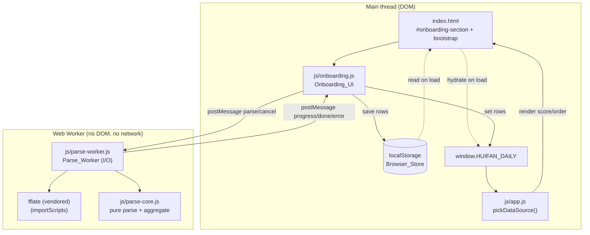

# Design Document

## Overview

Browser onboarding gives a new 烩饭 user a way to turn their Apple Health
`export.zip` into a personal daily dataset entirely inside their browser — no
Python, no server, no network call that carries health data. Today the only
path to data is `scripts/parse_health.py`, which a normal user cannot run. This
feature adds a first-run flow that explains how to export Health data, lets the
user pick the file, parses it locally in a Web Worker (streaming both the unzip
and the XML so the whole file is never held in memory), and stores the result
so the existing app reads it through `window.HUIFAN_DAILY`.

The hard constraint is **record parity**: the browser parse must produce the
same daily records as `scripts/parse_health.py` for the same export, so the
recovery score, patterns, and insights behave identically no matter which path
produced the data (Requirement 5).

### How it fits the existing app

The app already loads data via `<script>` tags that set globals, and
`js/app.js`'s `pickDataSource()` prefers `window.HUIFAN_DAILY`, then
`window.HUIFAN_SAMPLE_DAILY` (read from `js/app.js`). Onboarding plugs into that
exact seam: on success it sets `window.HUIFAN_DAILY` and persists the dataset to
`localStorage`; a tiny bootstrap in `index.html` re-hydrates the global from
`localStorage` on the next load **before** `app.js`'s `DOMContentLoaded` handler
runs `pickDataSource()`. Nothing in `score.js`, `order.js`, `patterns.js`, or
`insights.js` changes.

The design honors the locked stack (steering `tech`): plain HTML + CSS +
vanilla JS, no framework, no build step, no runtime `npm install`. The one new
piece of vendored code is **fflate** (MIT), committed as a single static file at
`js/vendor/fflate.min.js` and loaded with `importScripts` in the worker — it is
not an npm runtime dependency. `npm` stays dev-only for the property tests under
`tests/`.

### Honest constraints

- **Served context required for onboarding.** Web Workers generally need an
  `http(s)` origin; many browsers refuse `new Worker()` from a `file://` page.
  So the onboarding flow needs the app served (any simple static server). The
  existing sample-data path still works from `file://`. This is stated in the
  UI and the README. (Relates to Requirement 2.)
- **n = 1.** This proves the flow works for one person's export shape, not that
  every historical Apple export variant parses perfectly. Copy stays modest.

## Architecture

The feature splits cleanly into three layers so the parity-critical logic is a
pure, DOM-free, Worker-free module that both the worker and the tests import:

1. **Onboarding UI** (`js/onboarding.js`) — DOM only. Renders the first-run
   screen, file picker, range option, progress + cancel, and delete control.
   Owns worker lifecycle and persistence. Mounts into a new
   `#onboarding-section` in `index.html`.
2. **Parse worker** (`js/parse-worker.js`) — I/O only. Reads the `File`/`Blob`,
   streams the unzip, feeds XML text chunks into parse-core, posts progress and
   the final rows. No DOM, no network.
3. **Parse core** (`js/parse-core.js`) — pure functions only. Record extraction
   from an XML chunk stream, interval merge, wake-date, daily mean/rounding,
   `buildDaily`, and `filterLastNMonths`. No DOM, no Worker, no I/O. This is the
   module the tests import and the module that must match `parse_health.py`.

### Dual consumption (no build step)

`js/parse-core.js` must work **both** inside a classic Web Worker (loaded via
`importScripts`, no ESM) **and** under vitest ESM `import`. The existing modules
already solve this with an IIFE that attaches to a global and also sets
`module.exports` when present (see `js/score.js`, `js/order.js`). Parse-core
reuses that exact pattern, with one addition for the worker:

```js
// js/parse-core.js (shape)
(function (root) {
  "use strict";
  // ... pure functions ...
  const api = { extractRecordsFromChunks, mergeIntervals, wakeDate,
                round2, dailyMean, buildDaily, filterLastNMonths,
                ASLEEP_VALUES, TYPES };
  if (typeof module !== "undefined" && module.exports) module.exports = api; // vitest
  root.HuifanParseCore = api; // browser window OR worker self
})(typeof self !== "undefined" ? self : this);
```

- In a **classic worker**, `importScripts("parse-core.js")` runs the IIFE and
  `self.HuifanParseCore` becomes available. No `import`/`export` keywords are
  used, so no module-type worker and no build step are needed.
- Under **vitest**, the test does `const core = require(".../parse-core.js")`
  via `createRequire`, exactly like `tests/score.property.test.js` already does.

This is the simplest approach that needs no bundler and no transpile. (Supports
Requirement 5.11's testability and Requirement 2's worker execution.)

### Component diagram



## Components and Interfaces

### Worker message protocol

`js/onboarding.js` ↔ `js/parse-worker.js` communicate only by `postMessage`.

**Messages in (UI → worker):**

```js
{ type: "parse", file: File, range: "6m" | "all" } // range default "6m"
{ type: "cancel" }                                   // cooperative stop
```

The UI posts the `File` reference itself (structured-clone transfers it),
so the UI thread never reads the whole file into an ArrayBuffer
(Requirement 2.1). For a hard stop the UI also calls `worker.terminate()`
(Requirement 4.3); the `cancel` message is the cooperative path so an
in-progress loop can bail between chunks.

**Messages out (worker → UI):**

```js
{ type: "progress", compressedRead: number, compressedTotal: number } // 2.x, 4.1
{ type: "done", rows: Daily_Record[] }                                 // 5.1
{ type: "error", reason: "not-a-zip" | "no-export-xml" | "parse-failed" } // 2.6, 4.4–4.6
```

`progress` reports bytes of the **compressed** export entry consumed (a stable,
monotonic denominator we know up front from the zip's local header), so the UI
can show a determinate bar. No fixed cadence is mandated — the worker posts
progress as it advances through chunks (Requirement 4.1).

### Onboarding UI (`js/onboarding.js`)

A new module following the IIFE + `window.HuifanOnboarding` pattern. Public
surface used by `index.html`/`app.js` and tested by example:

```js
window.HuifanOnboarding = {
  // Pure predicate: should we show the first-run screen? (1.1)
  shouldFirstRun(storeValue, globalValue): boolean,
  // Persistence helpers (6.1, 6.4, 6.5) — wrapped in try/catch.
  saveDataset(rows): boolean,       // false if storage unavailable
  loadDataset(): Daily_Record[] | null,
  deleteDataset(): void,            // removes key + clears window.HUIFAN_DAILY
  STORAGE_KEY: "huifan.daily.v1",
  // Mounts the flow into a container element id. (1.2–1.4, 3.x, 4.x, 7.x).
  // mount also wires a "Try with sample data" button that renders from
  // window.HUIFAN_SAMPLE_DAILY for the session; it adds no new persisted state.
  mount(sectionId): void,
};
```

- **First-run detection (1.1, 6.6-style gate):** `shouldFirstRun` returns true
  when neither the store nor `window.HUIFAN_DAILY` holds a non-empty dataset.
  `mount` shows onboarding when true, otherwise stays out of the way so the
  normal app renders.
- **Export instructions (1.2):** three short steps — open Health, open your
  profile, choose "Export All Health Data".
- **File picker (1.3, 1.4):** `<input type="file" accept=".zip">`; a one-line
  privacy statement that the file is parsed in the browser and never sent
  anywhere.
- **Range option (3.1, 3.2):** two radio choices, "Last 6 months" (default) and
  "Everything"; the choice maps to `range: "6m" | "all"` in the parse message.
- **Progress + cancel (4.1–4.3):** on `progress`, update a determinate bar; a
  Cancel button terminates the worker, discards partial state, and returns to
  the picker.
- **Error handling (4.4–4.6):** map each `error.reason` to calm copy and return
  to the picker; never save a partial dataset.
- **Success (6.1, 6.2):** `saveDataset(rows)`, set `window.HUIFAN_DAILY = rows`,
  then re-render the app (call the same render entry `app.js` uses on boot).
- **Delete (6.3, 6.4):** a "Delete my data" control calls `deleteDataset()` and
  returns to the first-run screen.
- **Try with sample data (9.1–9.5):** a "Try with sample data" control on the
  first-run screen. On activation it reads `window.HUIFAN_SAMPLE_DAILY` (the
  bundled synthetic `Sample_Dataset` from `data/sample-daily.js`) and calls the
  app re-render entry (`window.HuifanApp.render`) to render from it — **without**
  calling `saveDataset` and **without** setting `window.HUIFAN_DAILY`, so the
  sample stays in-memory for the session only. Because `app.js`'s
  `pickDataSource` already shows the "sample" badge when `window.HUIFAN_DAILY` is
  absent and the sample global is present, rendering this way naturally surfaces
  the synthetic-data badge. A "Use my own export" back control returns to the
  first-run screen so the user can switch to parsing their own export.
- **Phone-width note (7.2, 7.3):** `matchMedia("(max-width: 480px)")` adds a
  calm note that uploading from a computer is easier, without blocking the
  picker.

### Re-render and load-order wiring (`index.html`)

`app.js` currently runs its render on `DOMContentLoaded`. Two small changes keep
the static-`<script>` model intact:

1. **Bootstrap before app.js.** A tiny inline script (or `js/bootstrap.js`)
   placed **before** `js/app.js` reads `localStorage` and, if a saved dataset
   exists, assigns `window.HUIFAN_DAILY = <rows>`. Because it runs before
   `app.js`'s `DOMContentLoaded` handler, `pickDataSource()` sees the real data
   and returns `source: "real"` with no other change (Requirement 6.2). The
   `data/daily.js` tag still wins if a developer has committed real data locally
   (it loads first and sets the same global).
2. **Re-render hook.** `app.js` exposes its boot routine (e.g.
   `window.HuifanApp.render()`) so onboarding can trigger a re-render after a
   successful parse without a full page reload (Requirement 6.2). The boot
   handler calls `render()` too, so behavior on first load is unchanged.

### Parse worker (`js/parse-worker.js`) — I/O layer

Responsibilities (Requirement 2):

- Receive `{type:"parse", file, range}`. Open the zip by reading the file as a
  **stream** (`file.stream()` / sliced `Blob` reads), never `file.arrayBuffer()`
  on the whole file.
- Locate the `export.xml` member (first entry whose name ends with
  `export.xml`, matching `parse_health.py`'s `name.endswith("export.xml")`).
  If the bytes are not a readable zip → post `error: "not-a-zip"`; if no such
  member → post `error: "no-export-xml"` (Requirements 2.6, 4.4, 4.5).
- **Stream-inflate** that member and feed decoded text chunks into parse-core's
  incremental scanner, so the full decompressed XML is never materialized
  (Requirements 2.2, 2.3).
- Maintain the parse-core accumulator across chunks; check a `cancelled` flag
  between chunks so `{type:"cancel"}` stops promptly (Requirement 4.3).
- On completion: build rows via `buildDaily`, apply `filterLastNMonths` when
  `range === "6m"`, post `{type:"done", rows}`.
- Post `progress` with compressed bytes read as it goes.

#### Decision 1 — Streaming unzip with no build step, no npm runtime dep

The `export.zip` is ~49 MB and its single large member decompresses to a much
larger XML; we must never hold the whole decompressed XML in memory
(Requirement 2.2, 2.3). Two realistic options:

- **(a) Native `DecompressionStream('deflate-raw')`.** Apple's zip stores the
  entry with raw DEFLATE. We read the local file header manually (signature
  `PK\x03\x04`, compression method, compressed size, filename length, extra
  length) to find the member and its byte range, then pipe the compressed bytes
  through `DecompressionStream('deflate-raw')` → `TextDecoderStream` and read
  chunks. Pure native, zero vendored code, truly streaming. Tradeoff: we hand-
  parse just enough of the zip container; data-descriptor entries (sizes in a
  trailing descriptor rather than the header) need the central directory read
  from the end of the file, which adds code. Browser support for
  `DecompressionStream` is good on current Chrome/Edge/Safari/Firefox but not on
  older browsers.
- **(b) Vendor a tiny static unzip helper** committed at
  `js/vendor/fflate.min.js` and loaded with `importScripts` in the worker. The
  library is **fflate** (https://github.com/101arrowz/fflate), a pure-
  JavaScript, dependency-free compression/decompression library whose streaming
  `Unzip` API processes the zip in chunks, handles the container quirks, and
  gives us a chunked read callback. License: **MIT, Copyright (c) Arjun
  Barrett**. Tradeoff: one committed third-party file to audit and attribute;
  still no npm install to run the app.

**Recommendation for the hackathon: (b) vendor fflate as a static file**, used
through a thin `openXmlStream(file)` adapter in the worker that exposes a chunk
callback, with **(a) as the preferred path when `DecompressionStream('deflate-raw')`
is available** (feature-detect; fall back to fflate for zip-container edge cases
such as data-descriptor entries and for browsers lacking `DecompressionStream`).
This keeps the happy path native and streaming while fflate covers container
edge cases and older browsers. The committed file is `js/vendor/fflate.min.js`,
loaded via `importScripts` in the worker; it is **not** an npm runtime
dependency and the app still runs by serving static files. Both paths stream and
never buffer the whole decompressed XML. (Supports Requirements 2.2, 2.4.)

**Attribution requirement.** The MIT license notice MUST be preserved: keep the
license header in the committed `js/vendor/fflate.min.js`, and add a
credits/attribution entry to `README.md` for fflate — its name, link
(https://github.com/101arrowz/fflate), and MIT license (Copyright (c) Arjun
Barrett).

#### Decision 2 — Streaming XML parse (incremental Record scanner)

We do not build a DOM over the whole XML. `DOMParser` is **not** available in a
Web Worker context, so the XML side MUST be a hand-written streaming/incremental
scanner (`extractRecordsFromChunks`) and must never use `DOMParser` or any
DOM-based XML API. Apple `Record` elements are self-closing with attributes,
e.g.:

```xml
<Record type="HKQuantityTypeIdentifierRestingHeartRate" sourceName="Watch"
        startDate="2024-03-01 07:30:00 -0500" endDate="2024-03-01 07:30:00 -0500"
        value="58"/>
```

`extractRecordsFromChunks` is a small stateful scanner (in parse-core, pure):

- Keep a rolling `buffer` string. On each incoming chunk, append to `buffer`.
- Repeatedly find the next complete `<Record ... />`. A complete element ends at
  the first `/>` (or `>` of a `</Record>` for the rare non-self-closing form)
  that is not inside a quoted attribute value. For each complete element, parse
  its attributes (`type`, `value`, `startDate`, `endDate`) with a small
  attribute regex/scan and emit a lightweight record, then **drop** that text
  from the buffer so memory stays flat (Requirement 2.3).
- **Chunk-boundary handling:** if a `<Record` has started but its closing `/>`
  has not arrived yet, leave the partial element in `buffer` and wait for the
  next chunk — a Record split across two chunks is reassembled before it is
  parsed. Text outside `Record` elements (headers, other element types) is
  skipped cheaply. This makes the scan **chunk-split independent**: feeding the
  same XML as one chunk or as any random split yields the same records (design
  Property 11, maps to Requirement 2.3).

### Parse core (`js/parse-core.js`) — pure API

All functions are pure (no DOM, no Worker, no I/O) and mirror `parse_health.py`
field-for-field.

```js
// Incremental XML scanner. Returns a stateful scanner object.
//   scanner.push(textChunk) -> void   (emits parsed raw records internally)
//   scanner.records -> RawRecord[]     (accumulated so far)
// RawRecord = { type, value?:string, startDate?:string, endDate?:string }
extractRecordsFromChunks(): Scanner

// Parse an Apple timestamp "YYYY-MM-DD HH:MM:SS ±HHMM" to epoch ms + local date.
// Mirrors Python strptime("%Y-%m-%d %H:%M:%S %z"); the local calendar date uses
// the offset in the string, matching Python's tz-aware .date().
parseAppleDateTime(s): { ms: number, dateISO: string } | null

// Merge (startMs, endMs) intervals; return total non-overlapping seconds.
// Input need not be sorted. Mirrors parse_health.merge_intervals.
mergeIntervals(intervals: [number, number][]): number

// Wake date = local calendar date of the interval end time (Requirement 5.7).
wakeDate(endDateISO: string): string

// Round half to even? No — match Python round(). round2 mirrors Python's
// round(x, 2) banker's rounding so values tie-break identically (5.2–5.4, 5.8).
round2(x: number): number

// Daily mean of values, or null if empty (never 0). Mirrors mean_or_none.
dailyMean(values: number[]): number | null

// Reduce accumulators into the sorted Daily_Dataset (Requirement 5.1).
buildDaily(acc: Accumulators): Daily_Record[]

// Keep rows whose date is within N months of the max date (Requirement 3.3).
// For range "all" this is not called (identity); see filter semantics below.
filterLastNMonths(rows: Daily_Record[], months: number): Daily_Record[]
```

**Rounding parity note.** Python's built-in `round()` uses banker's rounding
(round-half-to-even); JavaScript's `Math.round` rounds half up. To hit
Requirement 5.11 (field-for-field parity including 2-dp values), `round2` must
replicate Python's behavior. The design mandates a `round2` that matches
`parse_health.py`'s `round(x, 2)` on the fixture; the parity test is the gate
that proves it. (Supports Requirements 5.2–5.4, 5.8, 5.11.)

**Last-N-months semantics.** The window is measured from the **most recent
record date in the dataset**, not today (Requirement 3.3), matching the idea
that the export's newest day anchors "recent". `filterLastNMonths` computes
`maxDate`, then keeps rows with `date >= maxDate - months`. For `range: "all"`
the worker skips the filter entirely, so "everything" is the untouched
`buildDaily` output (Requirement 3.4).

## Data Models

### Daily_Record (output; identical to `parse_health.py` and the app)

```js
{
  date: "YYYY-MM-DD", // local calendar date
  hrv: number | null,  // HRV SDNN (ms), daily mean by start date, 2dp
  rhr: number | null,  // resting HR (bpm), daily mean by start date, 2dp
  resp: number | null, // respiratory rate (breaths/min), daily mean, 2dp
  sleep_h: number | null // merged asleep hours for the wake date, 2dp; null if 0
}
```

`Daily_Dataset` is `Daily_Record[]` sorted ascending by `date` with unique dates
(Requirement 5.1).

### Intermediate accumulators (worker-internal, pure)

```js
Accumulators = {
  hrv:  { [dateISO]: number[] },  // values by start-date day
  rhr:  { [dateISO]: number[] },
  resp: { [dateISO]: number[] },
  sleep:{ [dateISO]: [number, number][] } // (startMs, endMs) by wake date
}
```

These mirror `parse_health.py`'s `hrv_vals`, `rhr_vals`, `resp_vals`, and
`sleep_intervals` dictionaries exactly, so `buildDaily` is a direct port of
`build_daily`. Record type identifiers and the asleep-stage set are named
constants matching the Python (`TYPES`, `ASLEEP_VALUES`).

### Browser_Store entry

- Key: `"huifan.daily.v1"`.
- Value: `JSON.stringify(Daily_Record[])`.
- All access wrapped in try/catch; failures degrade gracefully
  (Requirements 6.1, 6.5).

## Correctness Properties

*A property is a characteristic or behavior that should hold true across all
valid executions of a system — essentially, a formal statement about what the
system should do. Properties serve as the bridge between human-readable
specifications and machine-verifiable correctness guarantees.*

These target the parity-critical pure logic in `js/parse-core.js` and are tested
with fast-check, independent of the DOM and the Web Worker.

### Property 1: Parse/reference parity (model-based)

*For any* committed synthetic fixture Health export, the `Daily_Dataset`
produced by `parse-core` over that fixture equals the record list produced by
the Reference_Parser (`scripts/parse_health.py`) over the same fixture — same
days, same values, same `null`s, same order — comparing field-for-field with
numeric values at 2-decimal-place precision.

**Validates: Requirements 5.11, 5.2, 5.3, 5.4, 5.8**

### Property 2: Sort order and shape (invariant)

*For any* set of accumulated records, the output `Daily_Dataset` is sorted
strictly ascending by `date` with no duplicate dates, and every row has exactly
the fields `date`, `hrv`, `rhr`, `resp`, `sleep_h`.

**Validates: Requirements 5.1**

### Property 3: Sleep interval merging (metamorphic)

*For any* set of asleep intervals on a night, the merged duration is less than
or equal to the sum of the individual durations, equal only when no two
intervals overlap; and adding an interval fully contained within an existing one
does not change the merged duration.

**Validates: Requirements 5.6**

### Property 4: Merge order independence (confluence)

*For any* set of asleep intervals, the merged duration is identical regardless
of the order in which the intervals are supplied.

**Validates: Requirements 5.6**

### Property 5: Wake-date assignment (invariant)

*For any* asleep interval, the record it contributes to has `date` equal to the
local calendar date of the interval's end time.

**Validates: Requirements 5.7**

### Property 6: Asleep-stage filtering (invariant)

*For any* mix of sleep records, records whose value is `InBed` or `Awake`
contribute zero duration to `sleep_h`, and only the five asleep stages
contribute.

**Validates: Requirements 5.5**

### Property 7: Null-not-zero (invariant)

*For any* day with no values for a metric, that metric in the output is `null`;
for any day whose merged asleep duration is zero, `sleep_h` is `null`; and no
present metric value is ever silently replaced by `0`.

**Validates: Requirements 5.9, 5.10**

### Property 8: Rounding (invariant)

*For any* day with values, each daily mean and `sleep_h` has at most 2 decimal
places and equals the full-precision value rounded to 2 decimals in the same way
the Reference_Parser rounds.

**Validates: Requirements 5.2, 5.3, 5.4, 5.8**

### Property 9: Last-N-months filter (metamorphic / subset)

*For any* dataset, the "last 6 months" result is exactly the subset of the
"everything" result whose assigned date is within 6 months of the most recent
record date; every "last 6 months" row appears in the "everything" result, and
the "everything" result equals the unfiltered `Daily_Dataset`.

**Validates: Requirements 3.3, 3.4**

### Property 10: Save/load round-trip (idempotence)

*For any* `Daily_Dataset`, saving it to the Browser_Store and loading it back
yields an equal `Daily_Dataset` (serialize/deserialize round-trip).

**Validates: Requirements 6.1**

### Property 11: XML scan chunk-boundary independence (confluence)

*For any* Export_XML text and *any* split of that text into sequential chunks,
feeding the chunks to the incremental scanner yields the same extracted records
as feeding the whole text at once.

**Validates: Requirements 2.3**

### Property 12: Sample data does not persist (invariant)

*For any* run of the "Try with sample data" path, the Browser_Store holds no
onboarding-saved Daily_Dataset and window.HUIFAN_DAILY is not set to the sample
data; the sample path is purely in-memory for the session.

**Validates: Requirements 9.3**

## Error Handling

| Condition | Where detected | Behavior | Requirement |
|---|---|---|---|
| Bytes are not a readable zip | worker | post `error: "not-a-zip"`; no rows retained | 2.6, 4.4 |
| Zip has no `export.xml` member | worker | post `error: "no-export-xml"`; no rows retained | 2.6, 4.5 |
| Any mid-parse failure (bad inflate, scanner throw) | worker | post `error: "parse-failed"`; no rows retained | 4.6 |
| Worker crash / `onerror` | UI | treat as `parse-failed`; friendly message; return to picker | 4.6 |
| User cancels | UI + worker | `worker.terminate()` + cooperative `cancel`; discard partial; return to picker | 4.3 |
| Malformed individual record (bad timestamp/value) | parse-core | skip that record, continue — mirrors Python's `except (ValueError, TypeError)` | 5.11 |
| `localStorage` unavailable / quota | UI | `saveDataset` returns false; still set `window.HUIFAN_DAILY` for the session | 6.5 |

All UI-facing error copy is calm and non-judgemental: the not-a-zip and
no-export-xml reasons both map to one friendly line that the file does not look
like an Apple Health export, with the picker shown again (Requirements 4.4, 4.5).
On every error path the UI discards partial data and never saves a dataset
(Requirements 2.6, 4.6).

## Testing Strategy

PBT applies here: `js/parse-core.js` is pure logic (parsing, interval math,
aggregation) with universal properties over a large input space, so it is the
right place for property-based tests. The UI, worker lifecycle, network-absence,
and storage side-effects are covered by example/integration tests instead.

### Parity test (the gate for Requirement 5.11)

1. Commit a **small synthetic** `apple_health_export/export.xml` fixture under
   `tests/fixtures/` — invented values only, no real health data, per steering
   privacy rules. It exercises the tricky cases: multiple sources with
   overlapping sleep intervals, asleep vs `InBed`/`Awake`, multiple values per
   day per metric, days missing some metrics, non-UTC timezone offsets, and
   values that stress 2-dp rounding (including a Python banker's-rounding
   half-case).
2. Run `scripts/parse_health.py` on that fixture to produce the expected rows,
   committed as `tests/fixtures/expected-daily.json` (regenerated by a documented
   command; also runnable in CI to catch drift).
3. A vitest test loads `js/parse-core.js` via `createRequire` (same approach as
   `tests/score.property.test.js`), streams the fixture XML through
   `extractRecordsFromChunks` + `buildDaily` (+ `filterLastNMonths` for the range
   cases), and asserts deep equality with the expected rows, field-for-field
   including `null`s and 2-dp numbers.

### Property-based tests (fast-check + vitest, dev-only under `tests/`)

- Library: **fast-check**, already a dev dependency (`tests/package.json`).
- Each of the 11 properties above is implemented as a **single** property test
  with **at least 100 iterations** (`fc.assert(fc.property(...), { numRuns: 100 })`).
- Each test is tagged with a comment referencing its design property, format:
  `// Feature: browser-onboarding, Property {n}: {property text}`.
- New file: `tests/parse-core.property.test.js`, loading `js/parse-core.js` via
  `createRequire` exactly like the existing score/order tests. No new runtime
  dependency; `npm` stays dev-only.
- Generators mirror the domain: timestamps in Apple format with varied offsets,
  interval sets (including contained/disjoint/overlapping), metric value lists
  with gaps, and mixed sleep stages. Property 11 uses an arbitrary that splits a
  generated XML string at random boundaries.

### Example / integration tests (not PBT)

- First-run predicate `shouldFirstRun` across the four store/global combinations
  (1.1).
- UI mount shows the three steps, file picker, privacy line, range radios with
  "Last 6 months" default, delete control (1.2–1.4, 3.1, 3.2, 6.3).
- Error-reason → friendly copy mapping and return-to-picker (4.4–4.6).
- Cancel terminates the worker and saves nothing (4.3).
- Success sets `window.HUIFAN_DAILY`, saves to the store, and `pickDataSource()`
  returns `source: "real"` (6.1, 6.2).
- Storage-unavailable path still exposes the global for the session (6.5).
- No network call during a parse (mock `fetch`/`XMLHttpRequest`/`sendBeacon`,
  assert zero calls) (2.5).
- Activating "Try with sample data" renders from `window.HUIFAN_SAMPLE_DAILY`,
  shows the sample badge, does NOT write the Browser_Store key, does NOT set
  `window.HUIFAN_DAILY`, and offers a way back to first-run (9.1–9.5).
- Phone-width note appears under a narrow media query without blocking the
  picker (7.2, 7.3).
- A `<7`-day dataset is saved, onboarding completes, and the app shows "still
  learning your baseline" (existing `score.js` behavior) (8.1, 8.2).
- Optional heavy fixture (~tens of MB synthetic) to confirm a large export
  completes and stays streaming; kept out of the default fast run (2.4).
